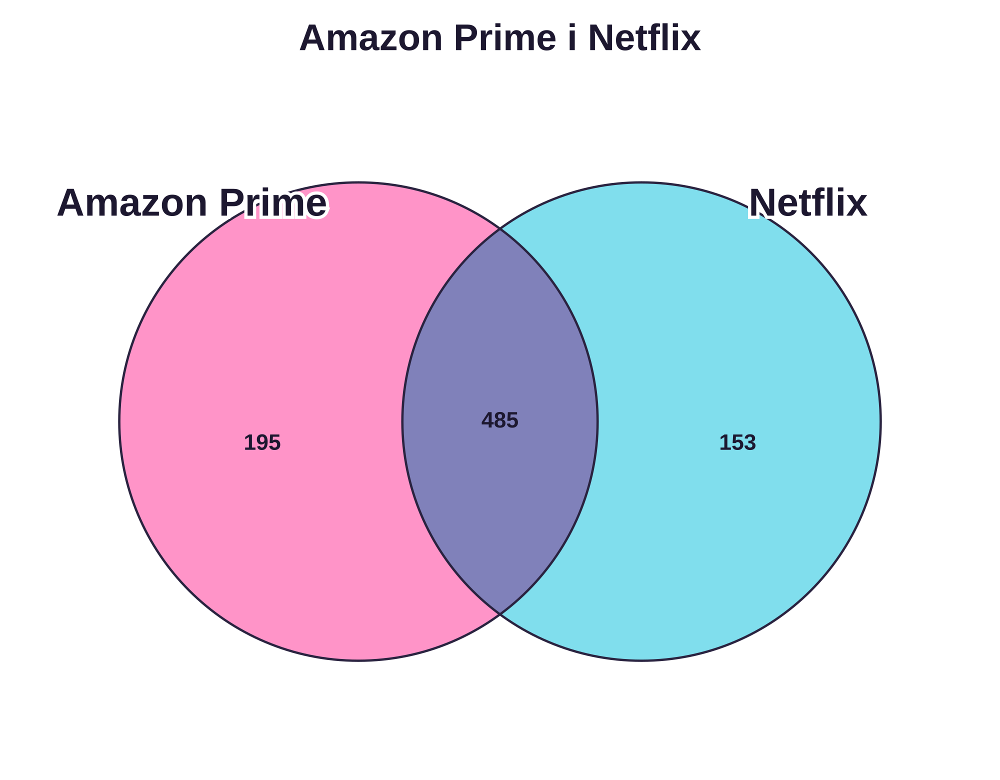
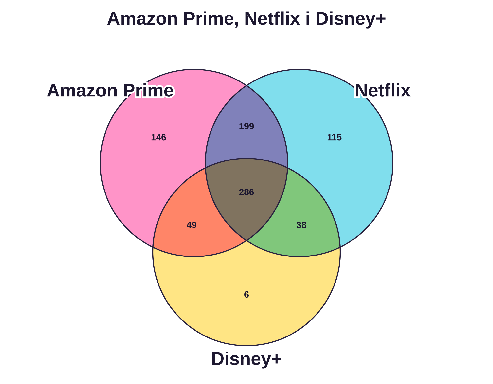
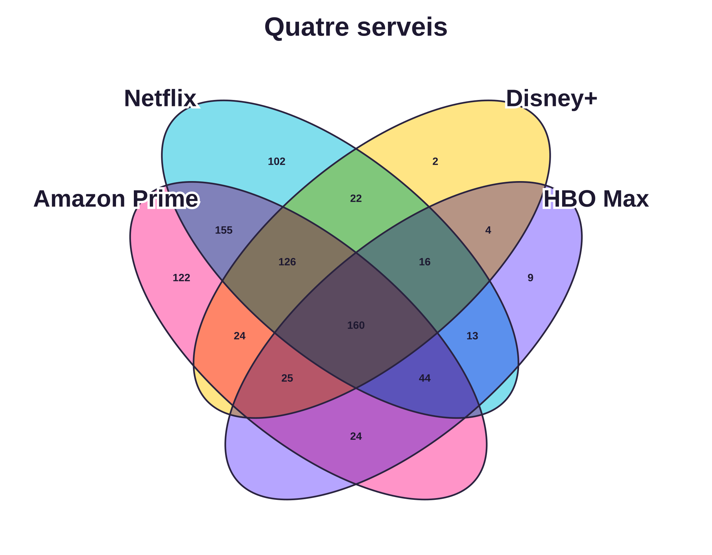
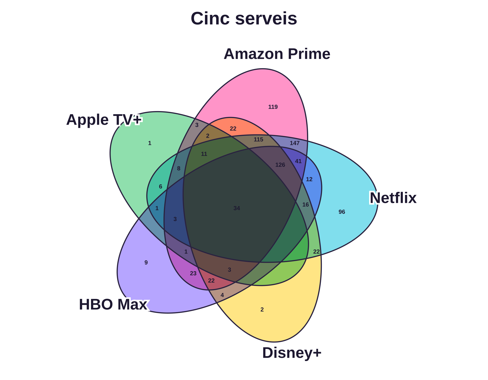

# Diagrames de Venn · serveis de vídeo a demanda

Solapament de subscripcions entre 849 usuaris actuals. Cada xifra indica una combinació exclusiva de serveis. Les àrees són esquemàtiques i no proporcionals als recomptes.

## 2 conjunts · Amazon Prime Video i Netflix

## 3 conjunts · s'hi afegeix Disney+

## 4 conjunts · s'hi afegeix HBO Max

## 5 conjunts · s'hi afegeix Apple TV+

Amb quatre i cinc conjunts el diagrama es fa difícil de llegir.

**Font:** Ignacio Redondo i Diana Serrano (2025), [conjunt de dades a Figshare](https://doi.org/10.6084/m9.figshare.26295868.v1), llicència [CC BY 4.0](https://creativecommons.org/licenses/by/4.0/). S'han seleccionat els usuaris actuals i cinc serveis; els identificadors s'han anonimitzat. Diagrames elaborats amb [VennMaker](https://vennmaker.io/). Els resultats corresponen a la mostra, no a la població general.
